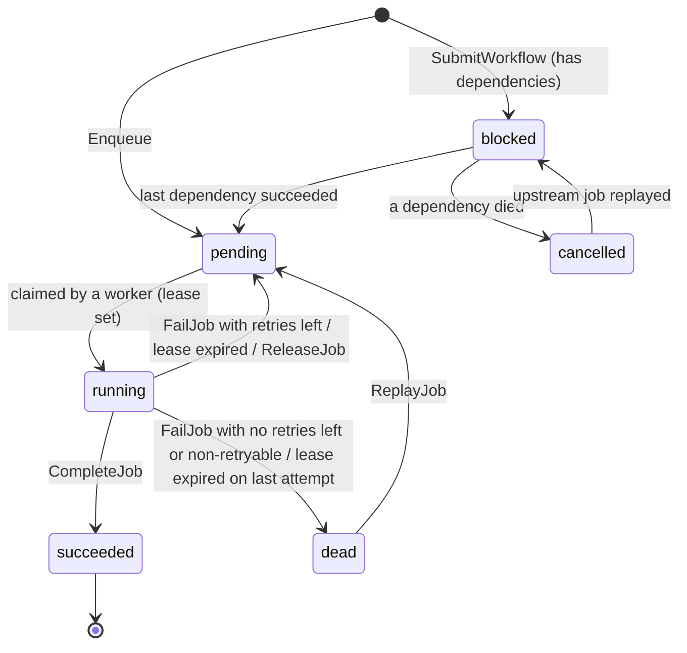

# Architecture

Filled in as we go. This file records the contracts that later phases must obey.

## Job lifecycle

A job is one row in the `jobs` table. Every state lives in that one table, in the `state`
column — not in a table per state. A transition is therefore a single atomic `UPDATE`
whose `WHERE` clause names the expected current state (law 3).

States: `blocked`, `pending`, `running`, `succeeded`, `dead`, `cancelled`.

**Terminal** means: no transition happens automatically. Only an explicit operator
action can move the job out. `succeeded` has no exit at all; `dead` exits only on
`ReplayJob`; `cancelled` exits only when an upstream job is replayed.

### Transitions

| From        | To          | Trigger                                                            | Built in  |
| ----------- | ----------- | ------------------------------------------------------------------ | --------- |
| (new)       | `pending`   | `Enqueue`                                                          | 3.1       |
| (new)       | `blocked`   | `SubmitWorkflow`, node has dependencies                            | 14.2      |
| `blocked`   | `pending`   | last dependency succeeded                                          | 14.3      |
| `blocked`   | `cancelled` | an upstream job became `dead`                                      | 14.4      |
| `pending`   | `running`   | `ClaimJobs` (worker fetch)                                         | 3.2       |
| `running`   | `succeeded` | `CompleteJob`                                                      | 3.3       |
| `running`   | `pending`   | `FailJob` with retries left                                        | 3.3, 10.2 |
| `running`   | `pending`   | lease expired (reaper)                                             | 8.1       |
| `running`   | `pending`   | `ReleaseJob` (graceful shutdown)                                   | 9.1       |
| `running`   | `dead`      | `FailJob` out of attempts or non-retryable; reaper on last attempt | 11.1      |
| `dead`      | `pending`   | `ReplayJob`                                                        | 11.2      |
| `cancelled` | `blocked`   | upstream job replayed                                              | 14.4      |

### Invariants

These must hold at every instant, including while other transactions are in flight.

1. `state = 'running'` ⇔ `lease_owner` and `lease_expires_at` are both non-NULL.
2. `completed_at` is non-NULL ⇔ `state` is terminal (`succeeded`, `dead`, `cancelled`).
3. `attempts` never goes down, except: `ReleaseJob` (−1, a shutdown is not the job's
   fault) and `ReplayJob` (reset to 0).
4. A job is claimable ⇔ `state = 'pending' AND run_at <= now()`.
5. `state = 'blocked'` ⇔ `pending_dependencies > 0` (Phase 14).

Invariant 4 is **derived, never stored**: claimability is a function of the row and the
database clock, so a stored boolean would go stale with no write to correct it. It lives
in the `WHERE` clause of the claim query. Comparisons use Postgres `now()` (law 2).

Invariants 1, 2 and 5 become `CHECK` constraints when their columns are added. Invariant
3 is enforced by the write path, because a `CHECK` sees only the new row and cannot
compare against the old value.
